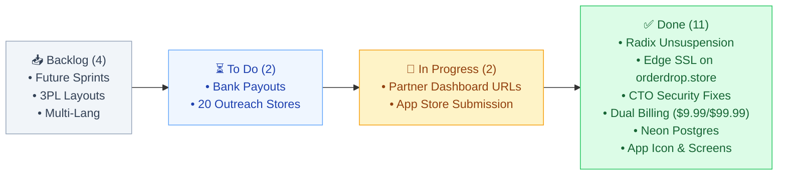

# 📦 OrderDrop · Master Agile Kanban Board

> **Interactive Column Drill-Downs**:  
> [[01_Backlog|📥 01 · Backlog (4)]] · [[02_To_Do|⏳ 02 · To Do (2)]] · [[03_In_Progress|🔄 03 · In Progress (2)]] · [[04_Done|✅ 04 · Done (11)]]



---

## 📥 Backlog
- [ ] [[01_Backlog#📦 CARD-01: Multi-Carrier & 3PL Custom Excel Layouts|Multi-Carrier & 3PL Custom Excel Layouts]] #feature #priority/medium ^card-01
- [ ] [[01_Backlog#📦 CARD-02: Multi-Language Warehouse Translation|Multi-Language Warehouse Translation (ES/FR/DE/ZH)]] #feature #priority/low ^card-02
- [ ] [[01_Backlog#📦 CARD-03: Multiple Daily Dispatch Schedules (Morning + Night)|Multiple Daily Dispatch Schedules for High-Volume Stores]] #automation #priority/medium ^card-03
- [ ] [[01_Backlog#📦 CARD-04: Reddit & Community Keyword Auto-Alerts|Reddit & Community Keyword Auto-Alerts (r/shopify)]] #gtm #marketing ^card-04

***

## ⏳ To Do
- [ ] [[02_To_Do#📋 CARD-06: Set Up Shopify Partner Payouts (Direct to Indian Bank)|Set Up Shopify Partner Payouts (Direct to Indian Bank)]] #finance #priority/high ^card-06
- [ ] [[02_To_Do#📋 CARD-08: Curate First 20 Outreach Store Prospects|Curate First 20 Outreach Store Prospects (1-to-1 DMs)]] #gtm #marketing ^card-08

***

## 🔄 In Progress
- [ ] [[03_In_Progress#🔄 CARD-07: Update App URL to Custom Domain in Partner Dashboard|Update App URL to Custom Domain in Partner Dashboard]] #devops #shopify-config #priority/high ^card-07
- [ ] [[03_In_Progress#🔄 CARD-05: Submit OrderDrop to Shopify App Store Review|Submit OrderDrop to Shopify App Store Review]] #launch #app-store #priority/highest ^card-05

***

## ✅ Done
- [x] [[04_Done#✅ CARD-10: Edge SSL & Branded Custom Domain Binding on Render|Edge SSL & Branded Custom Domain Binding on Render]] #devops #render #ssl ^card-10
- [x] [[04_Done#✅ CARD-09: Radix Registry Unsuspension & Global Domain Activation|Radix Registry Unsuspension & Global Domain Activation]] #domain #dns #radix ^card-09
- [x] [[04_Done#✅ CARD-19: CTO Security Audit Remediations & Hardening|CTO Security Audit Remediations & Hardening (HMAC Tokens & Formula Sanitization)]] #security #cve ^card-19
- [x] [[04_Done#✅ CARD-11: Dual Recurring Subscription Billing ($9.99/mo & $99.99/yr)|Dual Recurring Subscription Billing ($9.99/mo & $99.99/yr with 7-Day Free Trial)]] #billing #revenue ^card-11
- [x] [[04_Done#✅ CARD-12: Cloud Database Persistence via Neon Serverless PostgreSQL|Cloud Database Persistence via Neon Serverless PostgreSQL]] #database #persistence ^card-12
- [x] [[04_Done#✅ CARD-13: Resend Enterprise Custom Domain Verification (SPF / DKIM / DMARC)|Resend Enterprise Custom Domain Verification (SPF/DKIM/DMARC) & Live Email Dispatch]] #email #dns ^card-13
- [x] [[04_Done#✅ CARD-14: Production Web Service Deployment on Render|Production Web Service Deployment on Render (Reverse Proxy rate-limiter fixed)]] #devops #render ^card-14
- [x] [[04_Done#✅ CARD-15: Warehouse Pick-and-Pack Excel Generation Engine|Warehouse Pick-and-Pack Excel Generation Engine (ExcelJS)]] #excel #engine ^card-15
- [x] [[04_Done#✅ CARD-16: Shopify OAuth Handshake & GDPR Mandatory Webhooks|Shopify OAuth Handshake & GDPR Mandatory Webhooks]] #shopify #security ^card-16
- [x] [[04_Done#✅ CARD-17: Pixel-Perfect Shopify App Store Visual Assets|Pixel-Perfect Shopify App Store Visual Assets (1200x1200px Icon + 3 Screens)]] #design #assets ^card-17
- [x] [[04_Done#✅ CARD-18: Automated Test Suite (5/5 Passing)|Automated Test Suite (5/5 Passing)]] #testing #ci ^card-18

***

%% kanban:settings
```json
{"kanban-plugin":"basic","columns-width":320,"show-relative-date":true,"show-checkboxes":true}
```
%%
